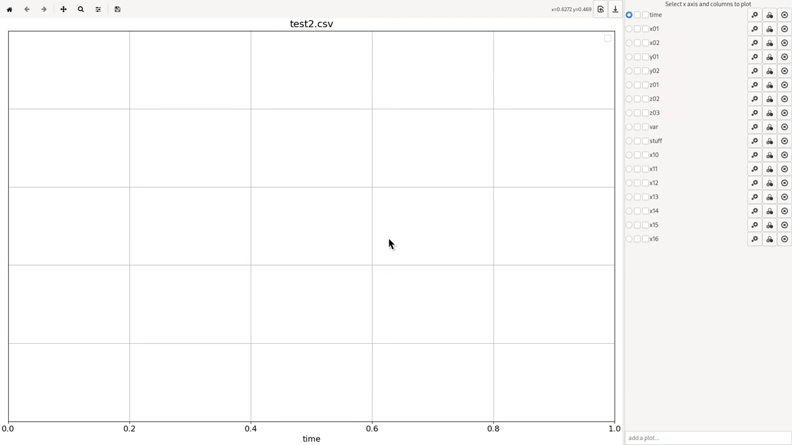
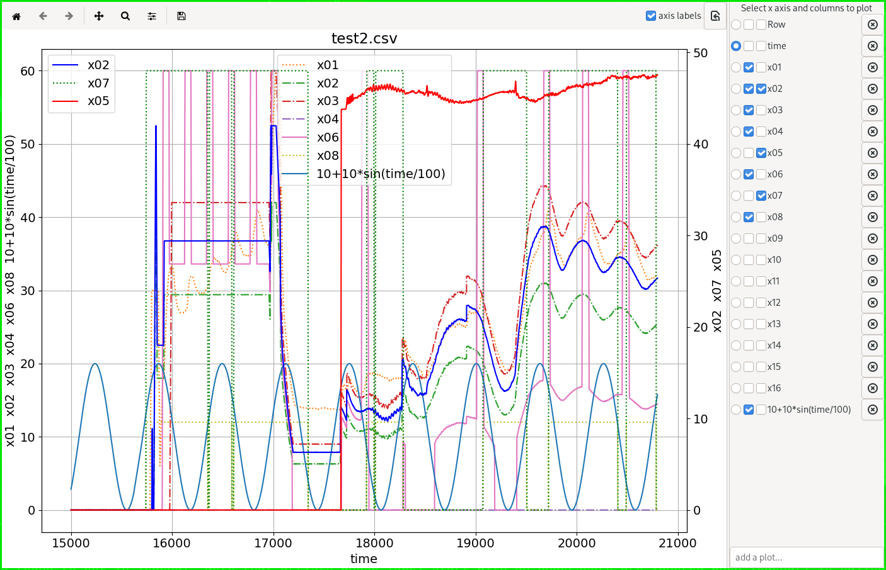

# csv_plotter.py

Interactively plot CSV, TSV (tab-separated), and HDF5 files.
## Demo

## Features
- matplotlib's plot window features:
    * image saving
    * mouse interaction (zoom, crop...)
- load comma-separated `.csv` and tab-separated `.tsv` files
- recognize Cystemas-style `[unit]` headers in TSV and CSV files, as well
  as separate HDF5 names/units metadata
- show units alongside editable variable names in the right-hand selector;
  the unit is separate from the name used in expressions
- disambiguate duplicate names with units: `pressure[bar]` and `pressure[Pa]`
  appear as `pressure [bar]` and `pressure [Pa]`, while their expression
  names are `pressure_bar` and `pressure_pa` (shown in tooltips)
- keep dot-separated namespaces grouped and names without dots ungrouped
- use internal names in expressions (`pressure_bar + pressure_pa`) or backtick
  quoted display labels (`` `pressure [bar]` + `pressure [Pa]` ``)
- save modified CSV, TSV, and HDF5 data with original source names and unit
  metadata preserved, including duplicate names with different units
- show Cystemas transfer-function identification metadata from HDF5
  `tf_param_*` (or legacy `tf_parameter_*`) datasets in a dedicated
  **TF identification** section of the Metadata tab
- preserve unrecognized HDF5 datasets, groups and attributes when saving
  edited HDF5 signals; only the signal table and its column descriptors
  are updated
- read explicit per-column colors from Cystemas HDF5 `/colors` metadata and
  TSV header metadata such as `Q [W]{color="#ff8800"; other="ignored"}`;
  colors that are empty, missing or unrecognized retain automatic plotting
  colors; unknown TSV metadata keys are ignored
- preserve colors when saving TSV and HDF5 files (including changes made with
  the color button); CSV output continues to omit color metadata
- handle TSV color values with escaped quotes, backslashes, tabs, newlines
  and carriage returns using Cystemas' metadata syntax
- select which columns to plot
- rename columns
- select X axis
- create new curves by inserting expressions parsed by `pandas.eval()`
- remove unwanted columns (for organization purposes)
    * Possibly save as a new file (also save new curves)
- command to reload file contents (in case you make external changes)
- **Spectrum** tab with one-sided FFT amplitude plots of selected signals,
  using the same left/right axis assignments, colors, and line styles as the
  time-domain plot and an independent Matplotlib navigation toolbar
- interactive FFT controls for Hann/rectangular window, mean removal,
  linear/relative dB amplitudes, full/visible time range, and frequency limits
- automatically interpolate gaps and irregular sample times for the Spectrum
  view, with a status message identifying affected signals

## Extended Cystemas TSV

The [version-1 TSV format specification](tsv-format.md) defines optional
scalar metadata and combined result files. The shared reference fixtures
are in `tests/fixtures/tsv_v1/`. The reader recognizes the exact first-line
`# cystemas-tsv:1` signature (with optional UTF-8 BOM) and validates the
metadata and optional time-series sections. Ordinary unmarked TSV and
legacy decisions tables continue to use the conventional reader. Invalid
extended files report the physical line number without falling back to TSV.

Combined TSV files expose scalar metadata alongside the time series, with
parameter and constant plot selectors and expression variables as for HDF5.
Metadata-only TSV and HDF5 files open the Metadata tab with the Plot and
Spectrum pages disabled; Save and Reload remain available. No synthetic
row or time axis is created. A combined file with only a time-series header
retains that header but has no samples to plot.

Saving an edited TSV creates a new TSV of the same variant (ordinary,
combined or metadata-only). Decoded metadata, including unknown kinds and
missing fields, is retained independently of edits to trajectory columns.
HDF5 saving retains the existing metadata and does not create trajectory
datasets for metadata-only files.

`csv_plotter_metadata.py` normalizes HDF5 scalar result metadata into the
same ten fields specified for TSV. It recognizes both canonical Cystemas
`param_*`, `fit_param_*`, `tf_param_*` dataset groups and legacy long-name
aliases. Groups must be complete and equivalent if both names are present.
The shared representation keeps configured and fitted values separate,
retains optional defaults, bounds, original decisions, optimization flags,
and initial-state snapshots (including incomplete older fit snapshots),
and represents missing fields with `None`. The existing pane, signal
selectors, scalar plotting and expression evaluation use format-independent
views of these rows. Additional initial-state pane sections, decision history,
and parameter defaults will be exposed in Stage 9. Scalar metadata is
not inserted into the loaded numerical table.

## Non-features
- CSV/TSV edition (use a text/spreadsheet editor instead)
    * You can only delete columns and add new ones by inserting expressions
      and save the resulting data frame as a new file
- open more than one file

## TODO
- ~~Add new curves as linear combinations of the existing data~~.
- ~~Add option to configurate color, linesize and linestyle for each curve.~~
  * ~~button to select color and style sequentially, not randomly~~
- ~~Use left and right axes to fit plots with different amplitudes.~~
- ~~Improve the positioning of the legends~~
  * ~~Make only one legend box with both axis lines.~~

## Dependencies
- matplotlib
- pygobject
- pandas

## Screenshot

## Frequency-domain computation (FFT)

`csv_plotter_fft.py` provides `amplitude_spectrum(time, signal, *,
window="hann", detrend="mean", missing="raise", sampling="raise",
sampling_rtol=1e-3, return_info=False)`.
It returns two NumPy arrays: nonnegative frequencies in Hz and the
corresponding one-sided amplitudes in the input signal's physical units.
The analysis uses `numpy.fft.rfft`, a periodic Hann window by default,
mean removal by default, and coherent-gain normalization. DC and the
Nyquist component (when present) are scaled without doubling.

Times must be strictly increasing and expressed in seconds. The numerical
function rejects irregular timestamps by default, but accepts
`sampling="interpolate"` to linearly resample them onto a uniform grid. The
new sample interval is inferred from the **median observed interval**, and
both time endpoints are preserved. Missing interior signal values (NaNs) can
be linearly filled with `missing="interpolate"`. Both options can be used
together. Invalid or repeated timestamps, infinite signal values, and missing
first/last signal samples are rejected; extrapolation is not performed. To
avoid excessive allocations, requests requiring more than 2,000,000
interpolated samples are rejected. Alternative options are
`window="rectangular"` and `detrend="none"`.

With `return_info=True`, the function returns a third dictionary describing
whether resampling and NaN interpolation occurred, the chosen sample interval,
and the number of FFT input samples. The default two-array return value is
unchanged. The numerical API remains strict unless interpolation is explicitly
requested; **the Spectrum tab enables both interpolation options automatically**.

The **Spectrum** tab computes the FFT of signals selected in the **Plot**
tab, using the currently selected X column as time in seconds. The Spectrum
tab refreshes when opened and when the selection, data, X column, or line
styles change while it is visible. Each signal's amplitude retains its
physical unit, with left and right axes corresponding to the Plot tab.
Spectrum navigation, zooming, and image export use a separate Matplotlib
toolbar. The original data and time-domain plot are not modified.

Spectrum controls above the plot allow choosing the **Hann** or
**Rectangular** window, **Remove mean** or **None** detrending, and
**Linear** or **dB (relative to peak)** amplitude. In dB mode, each signal's
largest FFT amplitude is 0 dB, and smaller amplitudes are displayed relative
to that peak, floored at -120 dB. dB amplitudes are therefore not in the
signal's original units and are not directly comparable across signals.
A signal with zero amplitude at every frequency is reported as unavailable in
dB mode.

The **Time range** menu offers **All samples** (default) or **Visible Plot
range**. To use the latter, zoom the time-domain Plot first and open the
Spectrum tab; it computes the FFT from only the timestamps inside the Plot's
visible X limits. The time selection must contain at least three samples.
A shorter interval changes the FFT's frequency resolution.

Optional **Min** and **Max** frequency fields are in Hz. Press **Apply Hz**
or Enter to restrict the displayed FFT bins; an empty maximum includes the
Nyquist frequency. These fields crop the *displayed spectrum*, not the
underlying data or the FFT resolution. Invalid limits leave the previous
valid settings intact.

Defaults remain Hann window, mean removal, linear amplitude, all samples,
and the full frequency range. The X axis must contain increasing times
measured in seconds. If its unit is missing, seconds are assumed and the tab
says so. The tab now automatically resamples irregular timestamp gaps and
fills interior NaNs by linear interpolation, reporting which signals required
those operations. Invalid timestamps or missing signal endpoints still produce
an error for the affected signal. The time-domain plot and source data are not
modified.

**Interpretation:** Interpolated samples are estimates, not new measurements.
Linear interpolation across long gaps can attenuate high-frequency content and
introduce spectral artifacts. The inferred median sampling interval cannot
recover an unknown original sampling rate; if the data contain large or
frequent gaps, interpret FFT peaks and amplitudes cautiously.
Run the tests with `python -m unittest discover -s tests`.
